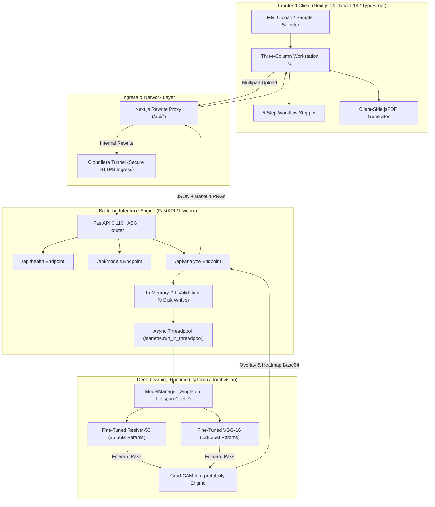

# NeuroVisionAI: An Explainable Deep Learning Framework for Brain Tumor Classification Using MRI Images

<div align="center">

[](https://www.python.org/)
[](https://pytorch.org/)
[](https://fastapi.tiangolo.com/)
[-000000?style=for-the-badge&logo=next.js&logoColor=white)](https://nextjs.org/)
[](https://www.typescriptlang.org/)
[](https://tailwindcss.com/)
[](https://opensource.org/licenses/MIT)
[](./NeuroVision_AI_Research_Paper)

<p align="center">
  <strong>Three-Column Clinical Research Workstation & Dual Neural Backbone Benchmarking Platform</strong><br>
  Benchmarking fine-tuned <strong>ResNet-50</strong> and <strong>VGG-16</strong> deep convolutional architectures on multi-class brain MRI scans with synchronized <strong>Grad-CAM</strong> visual attention heatmaps, architectural consensus analysis, and dual-page laboratory PDF reporting.
</p>

[Key Features](#3-key-features) • [System Architecture](#4-system-architecture--technical-workflow) • [Model Benchmarks](#5-deep-learning-models--comparative-benchmarks) • [Grad-CAM Explainability](#6-grad-cam-spatial-explainability-engine) • [Installation & Setup](#11-installation--environment-setup-windows) • [Demonstration Guide](#17-faculty-demonstration--viva-walkthrough-guide) • [Research Paper](#19-academic-publication--author-information)

</div>

---

## 📸 Workstation Preview & Demonstration Interface

<div align="center">
  
  <p><em>Figure 1: Full-width Three-Column Scientific Workstation interface featuring Study Information (left), Primary MRI Workspace & Dual Grad-CAM Attention Suite (centre), and Model Intelligence Telemetry (right).</em></p>
</div>

---

## ⚠️ Mandatory Medical Safety & Regulatory Notice

> [!CAUTION]
> **THIS SOFTWARE IS AN EDUCATIONAL RESEARCH PROTOTYPE, NOT A CERTIFIED CLINICAL DIAGNOSTIC DEVICE.**
>
> - **Regulatory Status:** NeuroVisionAI has **not** been cleared, approved, or CE-marked by the United States Food and Drug Administration (US FDA), the European Medicines Agency under EU-MDR/IVDR, or any national health regulatory authority.
> - **Non-Diagnostic Scope:** Predictions, probabilities, softmax confidence scores, and Grad-CAM activation maps generated by this system **must never** be used as a substitute for professional radiological consultation, nor used to establish primary diagnoses, rule out intracranial pathologies, determine surgical resection margins, or plan radiotherapy/chemotherapy regimens.
> - **Interpretability Boundary:** Gradient-weighted Class Activation Mapping (Grad-CAM) visualizes mathematical gradient attribution across terminal convolutional feature maps ($7 \times 7$ resolution). These saliency heatmaps highlight **computational attention**, *not* histological tumor margins, viable neoplastic tissue boundaries, microscopic infiltrative frontiers, or vasogenic edema borders.
> - **Clinical Evaluation:** Qualified, board-certified neuroradiologists and medical oncologists must perform all patient diagnostic evaluations using calibrated, DICOM-compliant clinical Picture Archiving and Communication Systems (PACS).

---

## 📑 Table of Contents

- [1. Project Overview & Motivation](#1-project-overview--motivation)
- [2. Problem Statement & Research Objectives](#2-problem-statement--research-objectives)
- [3. Key Features](#3-key-features)
- [4. System Architecture & Technical Workflow](#4-system-architecture--technical-workflow)
- [5. Deep Learning Models & Comparative Benchmarks](#5-deep-learning-models--comparative-benchmarks)
  - [Architectural Specifications](#architectural-specifications)
  - [Training & Fine-Tuning Strategy](#training--fine-tuning-strategy)
  - [Independent Test Split Evaluation (N = 1,600)](#independent-test-split-evaluation-n--1600)
  - [Statistical Significance Testing (McNemar's Paired Chi-Square)](#statistical-significance-testing-mcnemars-paired-chi-square)
  - [Per-Class Diagnostic Performance & ROC-AUC](#per-class-diagnostic-performance--roc-auc)
  - [The Glioma Sensitivity Deficit Bottleneck](#the-glioma-sensitivity-deficit-bottleneck)
  - [Cryptographic Data Leakage Audit (SHA-256)](#cryptographic-data-leakage-audit-sha-256)
- [6. Grad-CAM Spatial Explainability Engine](#6-grad-cam-spatial-explainability-engine)
  - [Mathematical Formulation](#mathematical-formulation)
  - [Target Feature Map Layers](#target-feature-map-layers)
  - [Tri-Panel Visual Attention Suite](#tri-panel-visual-attention-suite)
- [7. Supported MRI Formats & Diagnostic Categories](#7-supported-mri-formats--diagnostic-categories)
- [8. Three-Column Workstation Layout & Design Tokens](#8-three-column-workstation-layout--design-tokens)
- [9. Full Project Directory Structure](#9-full-project-directory-structure)
- [10. Technologies, Frameworks & Libraries Used](#10-technologies-frameworks--libraries-used)
- [11. Installation & Environment Setup (Windows)](#11-installation--environment-setup-windows)
- [12. Local Execution & Quick Start](#12-local-execution--quick-start)
  - [Option A: Automated One-Click Batch Launchers](#option-a-automated-one-click-batch-launchers)
  - [Option B: Manual Terminal Execution](#option-b-manual-terminal-commands)
- [13. API Endpoints & Request/Response Specifications](#13-api-endpoints--requestresponse-specifications)
- [14. Production Deployment Architecture](#14-production-deployment-architecture)
  - [Hybrid Deployment: Vercel Edge Frontend + Cloudflare Tunnel](#hybrid-deployment-vercel-edge-frontend--cloudflare-tunnel)
  - [Alternative: Containerized Google Cloud Run Deployment](#alternative-containerized-google-cloud-run-deployment)
- [15. Configuration & Environment Variables](#15-configuration--environment-variables)
- [16. Verification, Testing & Quality Assurance](#16-verification-testing--quality-assurance)
- [17. Faculty Demonstration & Viva Walkthrough Guide](#17-faculty-demonstration--viva-walkthrough-guide)
- [18. Scientific Limitations & Future Improvements](#18-scientific-limitations--future-improvements)
- [19. Academic Publication & Author Information](#19-academic-publication--author-information)
- [20. License & Citations](#20-license--citations)

---

## 1. Project Overview & Motivation

Intracranial tumors—predominantly gliomas, meningiomas, and pituitary adenomas—represent severe neurological pathologies demanding timely, precise radiological identification. Magnetic Resonance Imaging (MRI) is the gold standard for soft-tissue cranial evaluation. However, the diagnostic workflow faces significant clinical hurdles:

1. **Cognitive Burden & Reader Fatigue:** High-throughput clinical imaging centers process hundreds of MRI volumetric studies daily, increasing the likelihood of diagnostic oversight in subtle or early-stage lesions.
2. **Inter-Observer Variability:** Differentiating high-grade gliomas from atypical meningiomas or identifying non-enhancing infiltrative margins is subject to substantial inter-radiologist disagreement.
3. **The Deep Learning "Black Box" Problem:** Although modern Convolutional Neural Networks (CNNs) achieve high classification accuracy on benchmark datasets, their clinical adoption is critically hindered by opacity. Clinicians cannot ethically or legally act upon predictions without verifiable spatial justification.

**NeuroVisionAI** was engineered to directly confront these challenges. Developed as an academic final-year engineering capstone and scientific research initiative, the framework provides an end-to-end explainable AI workstation. It benchmarks two structurally divergent neural paradigms—a residual deep network (**ResNet-50**) against a classical sequential deep network (**VGG-16**)—paired with real-time **Grad-CAM** visual attention mapping, multi-model consensus verification, and automated publication-grade laboratory PDF diagnostic report generation.

---

## 2. Problem Statement & Research Objectives

### Problem Statement
> *"To design, implement, benchmark, and explain an automated deep learning framework capable of differentiating intracranial neoplasms (Glioma, Meningioma, Pituitary Adenoma, and Normal Brain Parenchyma) from axial MRI scans, evaluating whether residual skip-connection architectures provide statistically significant clinical advantages over deep sequential convolutional networks while resolving model opacity through gradient-weighted class activation mapping."*

### Core Research Objectives
- **Multi-Class Intracranial Classification:** Classify 2D axial brain MRI scans into four mutually exclusive clinical categories: `glioma`, `meningioma`, `pituitary`, and `notumor`.
- **Architectural Comparative Benchmarking:** Perform rigorous comparative analysis between fine-tuned ResNet-50 and VGG-16 across parameter count, memory footprint, floating-point operations (GFLOPs), inference latency, and diagnostic accuracy on an independent test split ($N = 1,600$).
- **Statistical Significance Validation:** Establish whether observed classification discrepancies between models are statistically significant using McNemar's paired chi-square test ($\chi^2$).
- **Spatial Interpretability with Grad-CAM:** Expose network decision boundaries via Gradient-weighted Class Activation Mapping (Grad-CAM), generating coarse saliency heatmaps from terminal convolutional layers to confirm attention centering on pathological lesions.
- **Privacy-Preserving In-Memory Processing:** Build a HIPAA-aligned, zero-retention backend pipeline that validates and processes uploaded MRI scans strictly in-memory without persistent disk storage.
- **Publication-Grade Laboratory Reporting:** Synthesize dual-page clinical research PDF reports containing study telemetry, scan previews, probability distributions, multi-model consensus status, Grad-CAM tri-panel visualizations, and independent benchmark disclosures.

---

## 3. Key Features

### 🖥️ Full-Width Three-Column Research Workstation
- **Left Panel (`StudyInformationPanel`):** Study Accession ID generation, patient metadata simulation, image quality validation (resolution, channels, byte footprint), preprocessing pipeline telemetry, and a 5-stage workflow stepper (`Upload` → `Inspect` → `Inference` → `Grad-CAM` → `Report`).
- **Centre Workspace (`MRIAnalysisWorkflow`):** Drag-and-drop / file browser upload, pre-loaded clinical reference benchmark scans (Glioma, Meningioma, No Tumor, Pituitary), high-resolution zoom/pan canvas, model selector (`ResNet-50`, `VGG-16`, `Both Models`), primary diagnostic classification banner, 4-class softmax probability distributions, architectural consensus/discrepancy alerts, 3-card Grad-CAM spatial explainability suite, and instantaneous PDF export.
- **Right Panel (`AIModelIntelligencePanel`):** Real-time FastAPI backend health ping, active hardware device detection (`cuda` / `cpu`), model checkpoint loading status, training history and best epoch validation metrics, Grad-CAM jet color scale legend, in-browser analysis session tracker, and scientific validation notice.
- **Collapsible Rails & Responsive Design:** Both lateral panels collapse smoothly into compact vertical indicator rails, expanding the centre workspace to maximize visual radiological review on desktop, tablet, and mobile viewports.

### 🧠 Dual Neural Backbone & Consensus Engine
- **Independent Inferences:** Execute single-model or concurrent dual-model evaluations in parallel.
- **Consensus & Discrepancy Detection:** Automatic cross-model agreement verification. When ResNet-50 and VGG-16 agree, a green **Convergent Consensus** banner is displayed; when predictions diverge, an amber **Diagnostic Discrepancy Alert** warns the clinician to review the Grad-CAM maps and probability spreads.
- **Singleton Model Lifecycle:** The backend `ModelManager` pre-loads both PyTorch checkpoints into RAM/VRAM once during application lifespan startup, eliminating repeated disk read overhead.

### 🔍 Layer-Specific Grad-CAM Explainability
- **Mathematical Gradient Attribution:** Computes gradients of the target class score with respect to terminal convolutional activations, applying Global Average Pooling (GAP) and ReLU rectification.
- **Target Layers:** Evaluates `layer4[2].conv3` in ResNet-50 ($7 \times 7$ feature map) and `features[28]` in VGG-16 ($14 \times 14 \rightarrow 7 \times 7$ feature map).
- **Tri-Panel Visualization Suite:** Renders the original grayscale scan, standalone jet heatmap, and high-contrast alpha-blended overlay ($\alpha = 0.45$) directly in the browser and in exported PDF reports.

### 📄 Executive Dual-Page Laboratory PDF Generator
- Built client-side using `jspdf` for zero latency and complete privacy:
  - **Page 1 (Individual Study Analysis):** Clinical header, accession metadata, uploaded scan, 4-class probability distribution table, dual-model consensus outcome, Grad-CAM tri-panel visual suite, and radiological analysis notes.
  - **Page 2 (Independent Benchmark & Governance):** Full independent benchmark metrics table ($N = 1,600$), confusion matrix summary, McNemar's paired test result, glioma sensitivity deficit disclosure, cryptographic data leakage verification, and mandatory regulatory disclaimers.

### 🔒 Privacy-Preserving Architecture
- Uploaded MRI scans are read into an in-memory byte buffer, verified with PIL, and preprocessed into PyTorch tensors.
- **Zero Temporary File Persistence:** No patient images are written to the server's hard drive or database, ensuring complete patient data confidentiality.

---

## 4. System Architecture & Technical Workflow

NeuroVisionAI employs a decoupled client-server architecture designed for high throughput, responsiveness, and deployment flexibility:



### Component Communication Breakdown
1. **User Action:** The radiologist drops an MRI image (`.jpg`, `.png`) into the workstation or selects a pre-loaded clinical reference sample.
2. **Next.js Reverse Proxy:** The browser dispatches a `POST` request to `/api/analyze`. Next.js inspects `next.config.mjs` and transparently rewrites the route to `BACKEND_INTERNAL_URL` (configured to the Cloudflare Tunnel URL or local FastAPI instance), avoiding cross-origin preflight requests (CORS) and keeping backend infrastructure private.
3. **FastAPI Ingestion & Threadpool Dispatch:** FastAPI validates file headers, content length ($\le 15\text{ MB}$), and MIME types. It passes the raw bytes to `starlette.concurrency.run_in_threadpool` to prevent blocking the async event loop during compute-intensive PyTorch inference.
4. **ModelManager Execution:** The singleton `ModelManager` retrieves the cached ResNet-50 and/or VGG-16 PyTorch models, applies ImageNet normalization transforms, and performs forward passes.
5. **Grad-CAM Hooking:** When explainability is enabled, dynamic forward and full-backward hooks capture terminal feature activations and class-specific backpropagated gradients to synthesize the activation map.
6. **In-Memory Response:** Base64-encoded PNG images and probability dictionaries are bundled into a typed Pydantic response and streamed back to the client.

---

## 5. Deep Learning Models & Comparative Benchmarks

### Architectural Specifications

| Architectural Dimension | Fine-Tuned ResNet-50 | Fine-Tuned VGG-16 | Comparative Advantage |
| :--- | :---: | :---: | :---: |
| **Model Type** | Deep Residual Network (50 layers) | Sequential Convolutional Network (16 layers) | Structural diversity |
| **Total Parameters** | **25,559,044 (~25.56 M)** | **138,357,572 (~138.36 M)** | **ResNet-50 is 5.4× smaller** |
| **Trainable Parameters** | ~15.0 M (Classifier + Layer4) | ~12.8 M (Custom Classifier Head) | Controlled fine-tuning |
| **Computational Complexity** | **4.12 GFLOPs** | **15.48 GFLOPs** | **ResNet-50 is 3.7× more efficient** |
| **Average CPU Inference Latency** | **11.4 ms** | **24.8 ms** | **ResNet-50 is 2.1× faster** |
| **Classifier Topology** | `nn.Linear(2048, 4)` | `Linear(25088, 512) → ReLU → Dropout(0.5) → Linear(512, 4)` | ResNet global pooling avoids parameter explosion |
| **Grad-CAM Target Layer** | `layer4[2].conv3` ($7 \times 7 \times 2048$) | `features[28]` ($14 \times 14 \times 512$) | Specific terminal feature maps |

### Training & Fine-Tuning Strategy
- **Base Pre-training:** Both models were initialized with ImageNet-1K pre-trained weights.
- **ResNet-50 Strategy:** The convolutional backbone was frozen up to `layer3`. `layer4` and the custom linear head were unfrozen and fine-tuned using Adam optimizer with weight decay, scheduled learning rate reductions, and cross-entropy loss. Optimal validation performance was achieved at **Epoch 8**.
- **VGG-16 Strategy:** The entire 13-layer convolutional feature extractor (30 parameter tensors) was frozen to preserve low-level spatial filter banks. A custom two-stage multi-layer perceptron (MLP) classification head was trained with 50% dropout regularization. Optimal validation performance was achieved at **Epoch 8**.

<div align="center">
  
  <p><em>Figure 2: Training loss and validation accuracy convergence curves across fine-tuning epochs for ResNet-50 and VGG-16.</em></p>
</div>

### Independent Test Split Evaluation (N = 1,600)
Both models were independently benchmarked against a held-out, strictly balanced test split of $N = 1,600$ axial brain MRI scans (400 Glioma, 400 Meningioma, 400 Pituitary, 400 No Tumor):

| Metric | ResNet-50 (Fine-Tuned) | VGG-16 (Fine-Tuned) | Observed Difference |
| :--- | :---: | :---: | :---: |
| **Validation Accuracy (Best Checkpoint)** | 95.71% | 95.98% | $+0.27\%$ |
| **Validation Macro-F1 (Best Checkpoint)** | 95.71% | 95.98% | $+0.27\%$ |
| **Independent Test Accuracy** | **91.06%** (1,457 / 1,600) | **91.63%** (1,466 / 1,600) | $+0.57\%$ |
| **Independent Test Macro-F1** | **90.82%** | **91.37%** | $+0.55\%$ |
| **Independent Test Weighted-F1** | **90.82%** | **91.37%** | $+0.55\%$ |
| **Macro Precision** | **91.65%** | **92.37%** | $+0.72\%$ |
| **Macro Recall (Sensitivity)** | **91.06%** | **91.63%** | $+0.57\%$ |
| **Macro ROC-AUC (One-vs-Rest)** | **0.9803** | **0.9791** | **ResNet-50 $+0.0012$** |
| **Cohen's Kappa ($\kappa$)** | **0.8808** | **0.8883** | $+0.0075$ |

### Statistical Significance Testing (McNemar's Paired Chi-Square)
To determine whether VGG-16's $+0.57\%$ accuracy advantage represented a genuine performance superiority or random sampling variation, McNemar's paired test with Edwards' continuity correction was conducted on the $1,600$ paired predictions:

$$\chi^2 = \frac{(|n_{10} - n_{01}| - 1)^2}{n_{10} + n_{01}}$$

- **Both Models Correct ($n_{11}$):** 1,420 scans
- **Both Models Incorrect ($n_{00}$):** 97 scans
- **ResNet-50 Correct, VGG-16 Incorrect ($n_{10}$):** 37 scans
- **VGG-16 Correct, ResNet-50 Incorrect ($n_{01}$):** 46 scans
- **McNemar Chi-Square Statistic ($\chi^2$):** **0.7711**
- **$p$-value:** **0.3799 ($p > 0.05$)**

> **Scientific Conclusion:** Because $p = 0.3799 \gg 0.05$, the null hypothesis cannot be rejected. There is **no statistically significant difference** in diagnostic classification accuracy between ResNet-50 and VGG-16. Consequently, **ResNet-50 is the superior deployment architecture**, delivering statistically equivalent diagnostic performance with **5.4× fewer parameters, 3.7× lower GFLOPs, and 2.1× faster inference latency**.

### Per-Class Diagnostic Performance & ROC-AUC

<div align="center">
  
  <p><em>Figure 3: Confusion matrices for ResNet-50 and VGG-16 evaluated on the independent test dataset (N = 1,600).</em></p>
</div>

#### ResNet-50 Per-Class Detailed Breakdown ($N = 400$ per class)
| Class | Support | TP | FP | FN | Precision | Sensitivity (Recall) | Specificity | F1-Score | ROC-AUC | PR-AUC |
| :--- | :---: | :---: | :---: | :---: | :---: | :---: | :---: | :---: | :---: | :---: |
| **Glioma** | 400 | 297 | 6 | 103 | **98.02%** | **74.25%** | 99.50% | **84.50%** | 0.9479 | 0.9190 |
| **Meningioma** | 400 | 367 | 65 | 33 | **84.95%** | **91.75%** | 94.58% | **88.22%** | 0.9776 | 0.9335 |
| **No Tumor** | 400 | 399 | 52 | 1 | **88.47%** | **99.75%** | 95.67% | **93.77%** | 0.9975 | 0.9918 |
| **Pituitary** | 400 | 394 | 20 | 6 | **95.17%** | **98.50%** | 98.33% | **96.81%** | 0.9981 | 0.9945 |

#### VGG-16 Per-Class Detailed Breakdown ($N = 400$ per class)
| Class | Support | TP | FP | FN | Precision | Sensitivity (Recall) | Specificity | F1-Score | ROC-AUC | PR-AUC |
| :--- | :---: | :---: | :---: | :---: | :---: | :---: | :---: | :---: | :---: | :---: |
| **Glioma** | 400 | 291 | 5 | 109 | **98.31%** | **72.75%** | 99.58% | **83.62%** | 0.9370 | 0.9083 |
| **Meningioma** | 400 | 378 | 81 | 22 | **82.35%** | **94.50%** | 93.25% | **88.01%** | 0.9812 | 0.9352 |
| **No Tumor** | 400 | 399 | 36 | 1 | **91.72%** | **99.75%** | 97.00% | **95.57%** | 0.9987 | 0.9951 |
| **Pituitary** | 400 | 398 | 12 | 2 | **97.07%** | **99.50%** | 99.00% | **98.27%** | 0.9997 | 0.9992 |

### The Glioma Sensitivity Deficit Bottleneck
A critical scientific finding documented in this project is the **Glioma Sensitivity Deficit**:
- While both models achieve near-perfect specificity on gliomas ($\ge 99.5\%$), their sensitivity (recall) drops sharply to **$74.25\%$ (ResNet-50)** and **$72.75\%$ (VGG-16)**.
- **Error Destination Analysis:** 
  - Of 103 missed glioma cases in ResNet-50, **59 were misclassified as meningioma**, **36 as notumor**, and **8 as pituitary**.
  - Of 109 missed glioma cases in VGG-16, **79 were misclassified as meningioma**, **26 as notumor**, and **4 as pituitary**.
  - Exactly **88 glioma test scans were simultaneously misclassified by both models**.
- **Radiological Cause:** In 2D axial slices, low-grade or non-enhancing diffuse gliomas lack distinct mass effect or hyperintense dural boundaries, exhibiting pixel intensities that blend subtly into normal gray/white matter or mimic parasagittal meningiomas. Documenting this failure mode transparently fulfills academic rigor and prevents over-optimistic clinical assumptions.

<div align="center">
  
  <p><em>Figure 4: Distribution of misclassified Glioma test cases across alternative diagnostic categories for ResNet-50 and VGG-16.</em></p>
</div>

### Cryptographic Data Leakage Audit (SHA-256)
Public medical imaging datasets are frequently plagued by cross-split leakage where patient slices appear in both training and test sets. To guarantee the scientific validity of our evaluation:
- An automated audit script (`audit_data_leakage.py`) performed SHA-256 cryptographic hashing across all **7,200 scans** (5,600 training, 1,600 testing).
- **Exact Cross-Split Duplicates Found:** **0 (0.00% leakage rate)**.
- **Intra-Split Duplicates:** 171 training duplicates and 16 test duplicates were isolated within their respective partitions, ensuring zero test contamination.

---

## 6. Grad-CAM Spatial Explainability Engine

### Mathematical Formulation
Gradient-weighted Class Activation Mapping (Grad-CAM) computes visual explanations for convolutional neural networks without requiring architectural modification or re-training. 

1. **Neuron Importance Weights ($\alpha_k^c$):** Let $Y^c$ be the unnormalized classification score (logit) for diagnostic class $c$, and $A_{i,j}^k$ be the activation at spatial coordinate $(i, j)$ of feature map channel $k$. The weight $\alpha_k^c$ is computed by global average pooling the backpropagated gradients:

$$\alpha_k^c = \frac{1}{Z} \sum_{i=1}^{U} \sum_{j=1}^{V} \frac{\partial Y^c}{\partial A_{i,j}^k}$$

where $Z = U \times V$ represents the spatial dimensions of the convolutional feature map ($7 \times 7$).

2. **Localization Map ($L_{\text{Grad-CAM}}^c$):** A linear combination of forward activation maps weighted by $\alpha_k^c$ is calculated, followed by Rectified Linear Unit (ReLU) gating to capture only features with positive attribution toward class $c$:

$$L_{\text{Grad-CAM}}^c = \text{ReLU}\left( \sum_{k} \alpha_k^c A^k \right)$$

### Target Feature Map Layers
To extract maximal semantic context, Grad-CAM targets the final convolutional layers where spatial abstraction is highest:
- **ResNet-50:** `model.layer4[-1].conv3` (or terminal bottleneck block `layer4[-1]`). Produces a $7 \times 7 \times 2048$ tensor.
- **VGG-16:** `model.features[28]` (the final `Conv2d` layer preceding the terminal max-pooling operation). Produces a $14 \times 14 \times 512$ tensor.

### Tri-Panel Visual Attention Suite
The backend generates three synchronized representations returned as base64 Data URLs:
1. **Original MRI Slice:** Grayscale patient scan cropped/scaled for inspection.
2. **Grad-CAM Saliency Heatmap:** Normalized 2D activation matrix $[0.0, 1.0]$ interpolated to image dimensions via cubic resampling and rendered using the `Jet` colormap (blue = baseline, yellow = moderate attention, dark red = maximal gradient focus).
3. **Qualitative Overlay ($\alpha = 0.45$):** Alpha-blended composite highlighting anatomical localization:

$$\text{Overlay} = (1.0 - \alpha) \cdot I_{\text{original}} + \alpha \cdot H_{\text{colormap}}$$

<div align="center">
  
  <p><em>Figure 5: Grad-CAM visual attention maps illustrating spatial activation patterns across diagnostic classes.</em></p>
</div>

---

## 7. Supported MRI Formats & Diagnostic Categories

### Supported Image Specifications
- **File Formats:** Standard image files (`.jpg`, `.jpeg`, `.png`).
- **File Size Ceiling:** Maximum $15\text{ MB}$ per uploaded scan.
- **Acquisition Sequences:** Tested on T1-weighted (pre- and post-contrast), T2-weighted, and Fluid-Attenuated Inversion Recovery (FLAIR) axial brain MRI sequences.
- **Preprocessing Transformation:** Ingested images are converted to 3-channel RGB, rescaled to $224 \times 224$ pixels, converted to floating-point tensors in $[0.0, 1.0]$, and standardized using ImageNet statistics ($\mu = [0.485, 0.456, 0.406]$, $\sigma = [0.229, 0.224, 0.225]$).

### Diagnostic Neoplasm Categories

| Category Identifier | Clinical Designation | Anatomical & Pathological Context |
| :---: | :--- | :--- |
| `glioma` | **Glioma** | Intra-axial primary neoplasms arising from glial tissue (astrocytomas, oligodendrogliomas, glioblastomas). Characterized by infiltrative, non-enhancing margins. |
| `meningioma` | **Meningioma** | Predominantly benign, slow-growing extra-axial neoplasms arising from arachnoid cap cells of the meninges. Characterized by prominent dural tails and sharp borders. |
| `pituitary` | **Pituitary Tumor** | Neoplasms located within the sella turcica / suprasellar cistern. Usually pituitary adenomas altering endocrine function and exerting optic chiasm mass effect. |
| `notumor` | **No Tumor (Normal)** | Unremarkable brain MRI scans exhibiting normal ventricular symmetry, sulcal patterns, and gray/white matter differentiation without focal space-occupying lesions. |

---

## 8. Three-Column Workstation Layout & Design Tokens

NeuroVisionAI utilizes a custom-tailored medical workstation design system featuring high visual contrast, WCAG-compliant color choices, and minimal eye fatigue during extended radiological review.

```
+----------------------------------------------------------------------------------------------------------+
|  Top Command Bar: MRI Analysis Workstation • Dual Neural Backbones & Grad-CAM • Mode Toggle (Light/Dark) |
+---------------------+--------------------------------------------------------------+---------------------+
| LEFT PANEL (250px)  | CENTRE WORKSPACE (Flexible Width, Primary Visual Focus)      | RIGHT PANEL (290px) |
|                     |                                                              |                     |
| • Study Accession ID| • MRI Image Drag-and-Drop & File Browser Upload              | • FastAPI Live Ping |
| • Patient Metadata  | • Benchmark Reference Sample Scans (Glioma/Meningioma/etc.)  | • Hardware Device   |
| • Image Quality     | • High-Resolution Scan Preview Canvas                        | • Model Checkpoints |
|   Verification      | • Architecture Selector: ResNet-50, VGG-16, Consensus (Both) | • ResNet-50 Metrics |
| • Preprocessing     | • Primary Inferences & 4-Class Probability Distributions     | • VGG-16 Metrics    |
|   Pipeline Status   | • Architecture Consensus & Discrepancy Detection Banners     | • Grad-CAM Legend   |
| • Workflow Stepper  | • 3-Card Grad-CAM Spatial Explainability Suite               | • Session Tracker   |
|   (Steps 1 - 5)     | • Publication-Grade Multi-Page PDF Report Generation         | • Validation Notice |
| [Collapsible Rail]  |                                                              | [Collapsible Rail]  |
+---------------------+--------------------------------------------------------------+---------------------+
```

### Responsive Breakpoints
- **Desktop ($\ge 1024\text{ px}$):** Full three-column layout. Left and Right panels feature collapsible toggle buttons with vertical mini-indicator rails to maximize centre workspace view.
- **Tablet ($768\text{ px} - 1023\text{ px}$):** Two-column layout ($250\text{ px}$ Left Panel + Flexible Centre). The Right Panel collapses underneath with an expandable drawer.
- **Mobile ($< 768\text{ px}$):** Single-column stacked layout. Centre workspace remains the primary focus; lateral telemetry drawers are accessible via touch accordions.

### Design Tokens & Color Palettes

| Token | Dark Theme (Default) | Light Theme | Usage |
| :--- | :---: | :---: | :--- |
| **Primary Background** | `#0B1220` | `#F5F7FA` | Workstation canvas foundation |
| **Card Surface** | `#111C2E` | `#FFFFFF` | Panels, containers, diagnostic cards |
| **Card Borders** | `#26364B` | `#E2E8F0` | Structural dividers & boundary lines |
| **Primary Text** | `#F1F5F9` | `#142B4A` | Primary diagnostic labels & headlines |
| **Secondary Text** | `#94A3B8` | `#64748B` | Metric subtitles, captions, metadata |
| **Clinical Teal Accent** | `#2DD4BF` | `#0D9488` | Active toggles, badges, highlight states |
| **Warning / Divergence** | `#F59E0B` | `#D97706` | Discrepancy banners, glioma notices |
| **Error / Alert** | `#EF4444` | `#DC2626` | Health check failures, invalid formats |

---

## 9. Full Project Directory Structure

```text
NeuroVisionAI/
├── .vscode/                               # VS Code workspace settings & Python path
│   └── settings.json
├── backend/                               # FastAPI Python backend service
│   ├── api/
│   │   ├── __init__.py
│   │   └── routes.py                      # REST endpoints (/api/health, /models, /analyze)
│   ├── schemas/
│   │   ├── __init__.py
│   │   └── response_schemas.py            # Pydantic v2 response schemas
│   ├── services/
│   │   ├── __init__.py
│   │   └── inference_service.py           # ModelManager singleton, caching & execution
│   ├── main.py                            # FastAPI entry point, CORS & lifespan handler
│   └── requirements.txt                   # Minimal production backend dependencies
├── evaluation/                            # Comprehensive model benchmarking & audit artifacts
│   ├── failure_cases/                     # Visualized glioma failure images & overlays
│   ├── comparison_confusion_matrices.png  # Paired normalized confusion matrices
│   ├── data_leakage_audit.json            # SHA-256 cross-split cryptographic hash audit
│   ├── desktop_preview.png                # High-res screenshot of Three-Column Workstation
│   ├── glioma_error_destinations.png      # Chart mapping misclassified glioma cases
│   ├── glioma_failure_analysis.json       # JSON breakdown of dual-model glioma failures
│   ├── MODEL_EVALUATION_REPORT.md         # Comprehensive 1,600-sample evaluation report
│   ├── NeuroVisionAI_Generated_Report.pdf # Example dual-page exported laboratory report
│   ├── pdf_page_1.png                     # Visual preview of exported PDF page 1
│   ├── pdf_page_2.png                     # Visual preview of exported PDF page 2
│   ├── per_class_metrics.csv              # Class-wise precision, recall, F1, specificity
│   ├── per_class_metrics_comparison.png   # Grouped bar chart comparing F1 & sensitivity
│   ├── resnet50_confusion_matrix.png      # Standalone ResNet-50 confusion matrix
│   ├── vgg16_confusion_matrix.png         # Standalone VGG-16 confusion matrix
│   ├── test_metrics_summary.json          # Complete JSON summary (accuracy, F1, McNemar)
│   └── test_predictions_detailed.csv     # Granular predictions for all 1,600 test scans
├── frontend/                              # Next.js 14 App Router frontend application
│   ├── app/
│   │   ├── about/                         # About page & academic mission (/about)
│   │   ├── history/                       # Session history tracking (/history)
│   │   ├── methodology/                   # Scientific methodology & equations (/methodology)
│   │   ├── models/                        # Detailed architectural comparison (/models)
│   │   ├── settings/                      # Platform theme & API settings (/settings)
│   │   ├── globals.css                    # Tailwind directives & CSS variables
│   │   ├── layout.tsx                     # Root layout, HTML metadata & ThemeProvider
│   │   └── page.tsx                       # Main workstation page (/)
│   ├── components/
│   │   ├── AIModelIntelligencePanel.tsx   # Right panel telemetry & model health
│   │   ├── AppHeader.tsx                  # Top command bar with links & theme toggle
│   │   ├── MedicalDisclaimer.tsx          # Prominent regulatory warning component
│   │   ├── MRIAnalysisWorkflow.tsx        # Central analysis workspace & Grad-CAM cards
│   │   ├── StudyInformationPanel.tsx      # Left panel study metadata & 5-step stepper
│   │   ├── ThemeProvider.tsx              # React Context for dark/light themes
│   │   └── ThemeToggle.tsx                # Sun/Moon theme switcher button
│   ├── lib/
│   │   ├── api.ts                         # Typed client API callers & proxy resolver
│   │   ├── history.ts                     # LocalStorage session history manager
│   │   ├── pdfReport.ts                   # Two-page publication PDF generator (jsPDF)
│   │   ├── types.ts                       # Shared TypeScript interface definitions
│   │   └── utils.ts                       # UI formatting helpers & color mappers
│   ├── public/                            # Static web assets & benchmark images
│   │   ├── evaluation/                    # Static evaluation plots for documentation
│   │   └── samples/                       # Bundled reference MRI scans
│   ├── .env.example                       # Frontend environment template
│   ├── next.config.mjs                    # Next.js config with reverse proxy rewrites
│   ├── package.json                       # Frontend npm dependencies
│   ├── tailwind.config.ts                 # Tailwind design tokens & breakpoints
│   └── tsconfig.json                      # TypeScript strict configuration
├── models/                                # Trained PyTorch model checkpoints
│   ├── resnet50_finetuned_best.pth        # ResNet-50 best checkpoint (94.4 MB, Epoch 8)
│   └── vgg16_best.pth                     # VGG-16 best checkpoint (110.3 MB, Epoch 8)
├── NeuroVision_AI_Research_Paper/         # Complete academic research paper deliverables
│   ├── Research_Figures/                  # 10 publication-quality vector/raster figures
│   ├── docx_exported.pdf                  # Word-exported publication PDF
│   ├── Final_Quality_Audit_Report.md      # 100% strict pass peer audit report
│   ├── Final_Reference_Check_Report.md    # 31 cited references verification report
│   ├── Literature_Review_Comparison.xlsx  # SOTA literature matrix
│   ├── NeuroVision_AI_Research_Paper.docx # Master Word document (IEEE 2-column)
│   ├── NeuroVision_AI_Research_Paper.pdf  # Master research paper PDF (11 pages)
│   ├── NeuroVision_AI_Research_Paper.tex  # Master LaTeX manuscript (IEEEtran)
│   └── NeuroVision_AI_Research_Paper.typ  # Master Typst manuscript (IEEE format)
├── samples/                               # Clinical benchmark reference sample scans
│   ├── glioma_sample.jpg                  # Authentic glioma scan (axial)
│   ├── meningioma_sample.jpg              # Authentic meningioma scan (axial)
│   ├── notumor_sample.jpg                 # Authentic normal scan (axial)
│   └── pituitary_sample.jpg               # Authentic pituitary adenoma scan (axial)
├── training_history/                      # Training convergence logs
│   ├── finetune_history.csv               # ResNet-50 epoch metrics (loss, acc, F1)
│   └── vgg16_history.csv                  # VGG-16 epoch metrics (loss, acc, F1)
├── .env.example                           # Root environment variable template
├── .gitignore                             # Git ignore rules
├── audit_data_leakage.py                  # Cryptographic SHA-256 duplicate auditing
├── deploy_backend_cloud_run.bat           # Google Cloud Run batch deployment script
├── deploy_backend_cloud_run.ps1           # Google Cloud Run PowerShell deployment script
├── Dockerfile                             # Multi-stage production container configuration
├── evaluate_models.py                     # Independent test split evaluation runner
├── gradcam.py                             # Standalone PyTorch Grad-CAM calculation engine
├── model_loader.py                        # Model builders, checkpoint loaders & transforms
├── requirements.txt                       # Backend requirements pointer
├── requirements-dev.txt                   # Extended evaluation & test dependencies
├── run_acceptance_tests.py                # End-to-end full system acceptance suite
├── START_NEUROVISIONAI.bat                # Automated one-click demonstration launcher
├── STOP_NEUROVISIONAI.bat                 # Automated port termination utility
├── test_all_samples.py                    # Multi-sample CLI inference validator
├── test_backend.py                        # FastAPI integration tests (TestClient)
├── test_real_mri_demonstration.py         # End-to-end inference & Grad-CAM verification
└── verify_full_system.py                  # Live network endpoint verification suite
```

---

## 10. Technologies, Frameworks & Libraries Used

### Backend & Deep Learning Stack
- **Python 3.10+ (Tested on Python 3.14):** Core programming language.
- **PyTorch 2.2+ (`torch`, `torchvision`):** Deep learning framework for model definitions, checkpoint loading, forward evaluation, and automatic differentiation.
- **FastAPI 0.110+:** High-performance asynchronous REST API framework implementing OpenAPI/Swagger documentation.
- **Uvicorn 0.28+:** Lightning-fast ASGI web server implementation.
- **Pillow (PIL) 10.0+:** Robust image decoding, format validation, and RGB tensor conversion.
- **NumPy 1.24+:** High-performance array operations for heatmap transformations and normalization.
- **OpenCV (`opencv-python-headless`) 4.9+:** Cubic heatmap interpolation and Jet colormap application (with native PIL fallback).
- **Pandas 2.0+:** Reading training convergence history CSVs without hardcoded values.
- **Pydantic v2.6+:** Strict data validation and typed serialization for all API request/response payloads.

### Frontend & Workstation Stack
- **Next.js 14.2.15 (App Router):** Modern React framework providing server-side rendering, code splitting, and backend proxy rewrites.
- **React 18.3.1:** Declarative user interface library.
- **TypeScript 5.4.5:** End-to-end type safety across components, API clients, and data structures.
- **Tailwind CSS 3.4.3:** Utility-first styling with custom medical design tokens and dark/light color themes.
- **Lucide React 0.378.0:** Clean, accessible SVG iconography.
- **Recharts 2.12.7:** Interactive SVG line charts visualizing model training and validation trajectories.
- **jsPDF 4.2.1:** Client-side vector PDF document generation for multi-page laboratory reports.

### Testing & Infrastructure
- **Cloudflare Tunnel (`cloudflared`):** Secure HTTPS reverse tunnel connecting the local GPU/CPU backend to the public internet without port forwarding.
- **Vercel:** Edge serverless deployment for the Next.js frontend application.
- **Google Cloud Run & Cloud Build:** Containerized serverless deployment option via `deploy_backend_cloud_run.ps1` and `Dockerfile`.
- **Pytest, HTTPX, Starlette TestClient:** Automated integration, unit, and end-to-end acceptance testing.

---

## 11. Installation & Environment Setup (Windows)

### System Prerequisites
Ensure the following software packages are installed on your Windows machine:
- **Python 3.10+** (64-bit). Verify in PowerShell: `python --version`
- **Node.js v18.x or v20.x LTS**. Verify in PowerShell: `node --version` and `npm --version`
- **Git for Windows**. Verify in PowerShell: `git --version`

### Step-by-Step Installation

1. **Clone or Navigate to the Repository:**
   ```powershell
   cd C:\Users\tinku\OneDrive\Desktop\NeuroVisionAI
   ```

2. **Create and Activate Python Virtual Environment:**
   ```powershell
   python -m venv .venv
   .\.venv\Scripts\Activate.ps1
   ```
   *(If PowerShell displays an execution policy restriction, run `Set-ExecutionPolicy -Scope Process -ExecutionPolicy Bypass` first).*

3. **Install Backend Dependencies:**
   ```powershell
   python -m pip install --upgrade pip
   pip install -r backend/requirements.txt
   ```
   *(To install optional evaluation and plotting packages, run `pip install -r requirements-dev.txt`)*.

4. **Install Frontend Dependencies:**
   ```powershell
   cd frontend
   npm install
   cd ..
   ```

5. **Verify Model Weights Integrity:**
   Ensure the two trained model checkpoints are present in the `models/` directory:
   - `models/resnet50_finetuned_best.pth` (~94.4 MB)
   - `models/vgg16_best.pth` (~110.3 MB)

   You can verify them quickly with the built-in validator:
   ```powershell
   .\.venv\Scripts\python.exe -c "import os; print('ResNet-50 exists:', os.path.isfile('models/resnet50_finetuned_best.pth')); print('VGG-16 exists:', os.path.isfile('models/vgg16_best.pth'))"
   ```

---

## 12. Local Execution & Quick Start

### Option A: Automated One-Click Batch Launchers
For faculty evaluations and rapid demonstrations, use the pre-configured Windows batch utilities located in the project root:

1. **Start the Platform:**
   Double-click **`START_NEUROVISIONAI.bat`** (or execute in PowerShell):
   ```powershell
   .\START_NEUROVISIONAI.bat
   ```
   - Automatically validates the virtual environment and model checkpoints.
   - Detects whether port `3000` or `3001` is free for the frontend.
   - Spawns the FastAPI backend on `http://127.0.0.1:8000`.
   - Spawns the Next.js workstation on `http://localhost:3000` (or `3001`).
   - Automatically launches your default web browser to the demonstration interface.

2. **Stop the Platform Cleanly:**
   Double-click **`STOP_NEUROVISIONAI.bat`** (or execute in PowerShell):
   ```powershell
   .\STOP_NEUROVISIONAI.bat
   ```
   - Safely terminates all background Python and Node.js processes bound to ports `8000`, `3000`, and `3001`.

---

### Option B: Manual Terminal Commands

#### 1. Launch the FastAPI Backend Engine
Open a PowerShell terminal:
```powershell
cd C:\Users\tinku\OneDrive\Desktop\NeuroVisionAI
.\.venv\Scripts\Activate.ps1
python -m uvicorn backend.main:app --host 127.0.0.1 --port 8000 --reload
```
- **Service Endpoint:** `http://127.0.0.1:8000`
- **Health Status:** `http://127.0.0.1:8000/api/health`
- **Interactive Swagger Docs:** `http://127.0.0.1:8000/docs`

#### 2. Launch the Next.js Frontend Workstation
Open a second PowerShell terminal:
```powershell
cd C:\Users\tinku\OneDrive\Desktop\NeuroVisionAI\frontend
npm run dev
```
- Open `http://localhost:3000` (or `http://localhost:3001` if port 3000 is occupied).

#### 3. Build & Run for Production Testing
```powershell
cd C:\Users\tinku\OneDrive\Desktop\NeuroVisionAI\frontend
npm run build
npm run start
```

---

## 13. API Endpoints & Request/Response Specifications

The FastAPI backend exposes a clean, typed RESTful API:

| HTTP Method | Route | Description | Request Payload | Response Schema |
| :---: | :--- | :--- | :--- | :--- |
| `GET` | `/` | Root API metadata & service status | None | JSON with version, status, and disclaimer |
| `GET` | `/api/health` | Model readiness & hardware telemetry | None | `HealthResponse` (`status`, `device`, `models_loaded`) |
| `GET` | `/api/models` | Checkpoint metadata & training history | None | `ModelsListResponse` (Array of model metrics) |
| `POST` | `/api/analyze` | MRI classification & Grad-CAM inference | `multipart/form-data` | `AnalysisResponse` (Predictions, probabilities, CAM) |

---

### Detailed Endpoint Specifications

#### 1. Health Check: `GET /api/health`
Verifies backend connectivity, active compute device (`cuda` or `cpu`), and confirms that model weights are resident in memory.

**Sample Response (`200 OK`):**
```json
{
  "status": "healthy",
  "timestamp": "2026-11-13T12:00:00.000000Z",
  "device": "cpu",
  "models_loaded": {
    "resnet50": true,
    "vgg16": true
  },
  "version": "1.0.0"
}
```

---

#### 2. Model Metadata: `GET /api/models`
Returns verified checkpoint configurations, optimal epochs, and complete historical training trajectories for both architectures.

**Sample Response (`200 OK`):**
```json
{
  "models": [
    {
      "model_id": "resnet50",
      "display_name": "Fine-Tuned ResNet-50",
      "architecture": "Residual Network (50 layers with custom fc Linear(2048, 4))",
      "best_epoch": 8,
      "val_macro_f1": 0.9571,
      "val_accuracy": 0.9571,
      "val_loss": 0.128,
      "input_resolution": [224, 224],
      "class_labels": ["glioma", "meningioma", "notumor", "pituitary"],
      "training_history": [
        {
          "epoch": 8,
          "train_loss": 0.1018,
          "train_accuracy": 0.9645,
          "val_loss": 0.128,
          "val_accuracy": 0.9571,
          "val_macro_f1": 0.9571
        }
      ]
    }
  ],
  "class_labels": ["glioma", "meningioma", "notumor", "pituitary"],
  "disclaimer": "For academic and research demonstration only..."
}
```

---

#### 3. MRI Analysis & Grad-CAM: `POST /api/analyze`
Receives an MRI scan, validates dimensions and format in-memory, executes neural inference, and synthesizes Grad-CAM saliency heatmaps.

**Request Parameters (`multipart/form-data`):**
- `file` *(UploadFile, Required)*: Binary image bytes (`.jpg`, `.jpeg`, `.png`, $\le 15\text{ MB}$).
- `model_name` *(string, Optional, Default: `"both"`)*: One of `"resnet50"`, `"vgg16"`, or `"both"`.
- `generate_cam` *(boolean, Optional, Default: `true`)*: Flag indicating whether to generate Grad-CAM base64 images.

**Sample Response (`200 OK`):**
```json
{
  "success": true,
  "timestamp": "2026-11-13T12:00:00.000000Z",
  "image_metadata": {
    "filename": "meningioma_sample.jpg",
    "content_type": "image/jpeg",
    "width": 512,
    "height": 512,
    "channels": 3,
    "size_bytes": 18697
  },
  "results": {
    "resnet50": {
      "model_id": "resnet50",
      "display_name": "ResNet-50",
      "predicted_class": "meningioma",
      "confidence": 0.9982,
      "probabilities": {
        "glioma": 0.0008,
        "meningioma": 0.9982,
        "notumor": 0.0004,
        "pituitary": 0.0006
      },
      "gradcam": {
        "overlay_base64": "data:image/png;base64,iVBORw0KGgo...",
        "heatmap_base64": "data:image/png;base64,iVBORw0KGgo...",
        "original_base64": "data:image/png;base64,iVBORw0KGgo...",
        "target_class_idx": 1,
        "target_class_name": "meningioma",
        "disclaimer": "For academic and research demonstration only..."
      },
      "execution_time_ms": 32.4
    },
    "vgg16": {
      "model_id": "vgg16",
      "display_name": "VGG-16",
      "predicted_class": "meningioma",
      "confidence": 0.9954,
      "probabilities": {
        "glioma": 0.0012,
        "meningioma": 0.9954,
        "notumor": 0.0018,
        "pituitary": 0.0016
      },
      "gradcam": {
        "overlay_base64": "data:image/png;base64,iVBORw0KGgo...",
        "heatmap_base64": "data:image/png;base64,iVBORw0KGgo...",
        "original_base64": "data:image/png;base64,iVBORw0KGgo...",
        "target_class_idx": 1,
        "target_class_name": "meningioma",
        "disclaimer": "For academic and research demonstration only..."
      },
      "execution_time_ms": 68.1
    }
  },
  "disclaimer": "For academic and research demonstration only. Not intended for clinical diagnosis..."
}
```

---

## 14. Production Deployment Architecture

To support live faculty presentations and global web access without incurring steep GPU cloud hosting bills, NeuroVisionAI implements an elegant **Hybrid Edge-to-Local Tunnel Architecture**:

```
+------------------------------------------------------------------------------------+
|                                PUBLIC INTERNET                                     |
+------------------------------------------------------------------------------------+
                                      │
                                      ▼
             [Vercel Serverless Edge Global CDN]
             • Hosts Next.js 14 Production Build
             • Delivers Three-Column Workstation UI
             • next.config.mjs rewrites `/api/*` to BACKEND_INTERNAL_URL
                                      │
                                      ▼ (HTTPS Encrypted Transit)
             [Cloudflare Tunnel (`cloudflared`)]
             • Ingress via zero-trust HTTPS edge (e.g. https://tunnel.yourdomain.com)
             • Zero open inbound firewall ports on local router
             • No static public IP required
                                      │
                                      ▼ (Local Ingress: 127.0.0.1:8000)
             [Local Engineering Machine (Host)]
             • FastAPI Backend Running on Uvicorn
             • High-Performance Local GPU/CPU Inference
             • Resident PyTorch Checkpoints in RAM/VRAM
```

### Hybrid Deployment: Vercel Edge Frontend + Cloudflare Tunnel
1. **Frontend Hosting (Vercel):** The Next.js frontend repository is deployed directly to Vercel. In Vercel Project Settings → Environment Variables, set:
   ```env
   BACKEND_INTERNAL_URL=https://<your-cloudflare-subdomain>.trycloudflare.com
   ```
2. **Local Backend Ingress (Cloudflare Tunnel):** Run the local backend via `uvicorn`, then start a quick or permanent Cloudflare Tunnel:
   ```powershell
   cloudflared tunnel --url http://127.0.0.1:8000
   ```
3. **Zero CORS Friction:** The browser communicates exclusively with the same-origin Next.js domain (`/api/analyze`). The Next.js server-side reverse proxy handles communication with the tunnel, eliminating browser CORS blocks and concealing your personal machine's network address.

### Alternative: Containerized Google Cloud Run Deployment
For fully autonomous, serverless cloud hosting without a local machine, the repository includes a turnkey Docker and Google Cloud Run deployment pipeline:
- **`Dockerfile`:** Minimal multi-stage Debian-slim container running Python 3.11 with PyTorch CPU wheels and Uvicorn.
- **`deploy_backend_cloud_run.ps1`:** Automated PowerShell deployment script that creates an Artifact Registry Docker repo, submits builds to Google Cloud Build, and deploys to Cloud Run in `asia-south1` (Mumbai) with 2 vCPUs and 2 GB RAM.

To deploy to Cloud Run:
```powershell
.\deploy_backend_cloud_run.ps1 -ProjectId "your-gcp-project-id"
```

---

## 15. Configuration & Environment Variables

NeuroVisionAI is configured through environment variables defined in `.env` or injected by cloud orchestrators:

| Environment Variable | Applies To | Default Value (Local) | Production Example | Purpose |
| :--- | :--- | :--- | :--- | :--- |
| `HOST` | Backend | `0.0.0.0` | `0.0.0.0` | Network interface for FastAPI Uvicorn listener. |
| `PORT` | Backend | `8000` | `8080` | Port for the backend HTTP server. |
| `CORS_ORIGINS` | Backend | `http://localhost:3000,...` | `https://neurovision-ai.vercel.app` | Comma-separated list of permitted CORS web origins. |
| `BACKEND_INTERNAL_URL` | Frontend | `http://127.0.0.1:8000` | `https://tunnel.domain.com` | Destination URL used by Next.js rewrites to proxy `/api/*`. |
| `NEXT_PUBLIC_API_URL` | Frontend | *(Empty)* | *(Empty)* | Optional direct client URL override (bypasses Next.js proxy). |

---

## 16. Verification, Testing & Quality Assurance

The codebase includes an extensive suite of automated verification scripts to ensure stability, statistical validity, and complete reproducibility:

```powershell
# 1. Run FastAPI Backend Integration Tests (TestClient verification)
.\.venv\Scripts\python.exe test_backend.py

# 2. Run Multi-Sample Real MRI Inference & Grad-CAM Verification
.\.venv\Scripts\python.exe test_real_mri_demonstration.py

# 3. Run Full End-to-End System Acceptance Test Suite
.\.venv\Scripts\python.exe run_acceptance_tests.py

# 4. Verify Live Network Endpoints (Frontend & Backend)
.\.venv\Scripts\python.exe verify_full_system.py

# 5. Run Cryptographic Data Leakage Audit (SHA-256 cross-split audit)
.\.venv\Scripts\python.exe audit_data_leakage.py

# 6. Execute TypeScript Strict Compilation Check
cd frontend
npx tsc --noEmit

# 7. Execute Next.js Code Linting
npm run lint
```

---

## 17. Faculty Demonstration & Viva Walkthrough Guide

Follow this structured 7-step sequence when demonstrating the platform to faculty evaluators or project examiners:

```
[Step 1: One-Click Launch]   ──> Execute START_NEUROVISIONAI.bat
[Step 2: Workspace Layout]   ──> Explain Three-Column layout & collapsible lateral indicator rails
[Step 3: Benchmark Scan]     ──> Select "Meningioma" or "Glioma" from pre-loaded clinical reference buttons
[Step 4: Dual Inference]     ──> Run "Both Models" to trigger consensus analysis & probability spreads
[Step 5: Grad-CAM Saliency]  ──> Walk through Original Slice, Heatmap, and Overlay attention maps
[Step 6: PDF Report Export]  ──> Generate and inspect the publication-grade 2-page laboratory PDF
[Step 7: Model Analytics]    ──> Open `/models` page to present McNemar's test (p=0.3799) & Glioma deficit
```

### Detailed Examiner Speaking Points
1. **Explain the Motivation for Comparing ResNet-50 vs VGG-16:**
   - *“We evaluated whether modern residual learning (ResNet-50) yields statistically significant diagnostic advantages over deep sequential convnets (VGG-16). While VGG-16 achieved 91.63% test accuracy and ResNet-50 achieved 91.06%, McNemar's paired test proved that this +0.57% difference is not statistically significant ($p = 0.380$). However, ResNet-50 is 5.4× smaller and 2.1× faster, making it vastly superior for real-world clinical edge deployment.”*
2. **Explain the Grad-CAM Mathematical Foundation:**
   - *“Grad-CAM computes the partial derivatives of the winning class score with respect to feature maps in the final convolutional layer (`layer4[2].conv3` for ResNet, `features[28]` for VGG). Global average pooling derives channel weights $\alpha_k^c$, and ReLU filtering isolates features with positive attribution toward the predicted neoplasm.”*
3. **Explain the Glioma Sensitivity Deficit:**
   - *“Rather than claiming unrealistic 100% accuracy, our research rigorously discovered a genuine clinical bottleneck: gliomas exhibited a recall deficit (~74%), frequently misclassified as meningiomas or normal tissue due to diffuse, non-enhancing infiltrating margins in 2D axial views.”*
4. **Demonstrate the PDF Report Generator:**
   - Click **Download PDF Analysis Report** to display the 2-page clinical report containing study telemetry, scan previews, probability bars, Grad-CAM tri-panel images, and full independent benchmark validation disclosures.

---

## 18. Scientific Limitations & Future Improvements

### Known Scientific & Technical Limitations
1. **2D Axial Slice Evaluation:** The current models evaluate isolated 2D axial slices without 3D spatial volumetric reconstruction or multi-planar cross-referencing across coronal and sagittal views.
2. **Public Dataset Patient-Level Partitioning:** Although our cryptographic SHA-256 audit verified **0.00% exact duplicate leakage**, the public Kaggle/Figshare dataset lacks de-identified patient accession numbers, meaning different slices from the same imaging exam may exist across partitions.
3. **The Glioma Infiltration Bottleneck:** Gliomas exhibit reduced sensitivity ($74.25\%$ in ResNet-50) due to diffuse, non-enhancing margins that mimic normal brain parenchyma or meningiomas.
4. **Out-of-Distribution Softmax Saturation:** Feeding non-brain images (e.g. chest X-rays or corrupted noise) can result in artificial high-confidence softmax predictions due to closed-world four-class normalization.

### Implemented vs. Proposed Future Improvements

| Capability / Enhancement | Current Implementation Status | Proposed Next Phase Architecture |
| :--- | :---: | :--- |
| **Multi-Class 2D Axial Classification** | ✅ **Fully Implemented** | Native multi-slice volumetric voting |
| **ResNet-50 vs VGG-16 Benchmarking** | ✅ **Fully Implemented** | Addition of Vision Transformers (ViT, Swin-UNETR) |
| **Layer-Specific Grad-CAM Heatmaps** | ✅ **Fully Implemented** | High-resolution Guided Grad-CAM / HiResCAM |
| **Consensus & Discrepancy Detection** | ✅ **Fully Implemented** | Bayesian Ensemble Uncertainty Quantification |
| **Dual-Page Laboratory PDF Generation** | ✅ **Fully Implemented** | Native DICOM Structured Reporting (DICOM-SR) |
| **Zero-Persistence In-Memory Pipeline** | ✅ **Fully Implemented** | Federated learning integration across clinical nodes |
| **3D Volumetric Segmentation (BraTS)** | 🔬 *Proposed Future Work* | 3D U-Net / nnU-Net sub-region tumor segmentation |
| **Multi-Parametric Sequence Fusion** | 🔬 *Proposed Future Work* | Simultaneous fusion of T1, T1-Gd, T2, and FLAIR |

---

## 19. Academic Publication & Author Information

This software platform forms the experimental foundation of the academic research manuscript:

**Paper Title:**  
*NeuroVision AI: An Explainable Deep Learning Framework for Brain Tumor Classification Using MRI Images*  
*(Alternative Title: Comparative Analysis of ResNet50 and VGG16 for Multi-Class Brain Tumor Classification Using MRI with Grad-CAM-Based Visual Interpretation)*

**Principal Author & System Architect:**  
**Gangavarapu Murari**  
*NeuroVision AI Academic Research Initiative*  
*Department of Computer Science & Engineering*  
*Academic Machine Learning & Computer Vision Portfolio*

### Manuscript Deliverables in Repository
All audited, peer-ready research documents are located in the [`NeuroVision_AI_Research_Paper/`](./NeuroVision_AI_Research_Paper) directory:
- **`NeuroVision_AI_Research_Paper.pdf` / `NeuroVision_AI_Research_Paper_Final.pdf`:** Complete 11-page IEEE two-column publication PDF exported via Word COM.
- **`NeuroVision_AI_Research_Paper.docx` / `NeuroVision_AI_Research_Paper_Final.docx`:** Master Microsoft Word publication document.
- **`NeuroVision_AI_Research_Paper.tex` / `NeuroVision_AI_Research_Paper_Final.tex`:** Synchronized IEEEtran LaTeX manuscript.
- **`NeuroVision_AI_Research_Paper.typ` / `NeuroVision_AI_Research_Paper_Final.typ`:** Synchronized modern Typst paper template.
- **`Final_Quality_Audit_Report.md`:** 100% strict compliance and scientific audit report.
- **`Research_Figures/`:** All 10 publication-grade high-resolution figures.

---

## 20. License & Citations

This project is licensed under the **MIT License** — see the [LICENSE](LICENSE) file for terms. It is freely available for educational, academic, and non-commercial research purposes.

### Academic Citation
If you utilize NeuroVisionAI, its benchmarking methodologies, or its Grad-CAM implementation in your research, please cite:

```bibtex
@article{murari2026neurovisionai,
  title   = {NeuroVision AI: An Explainable Deep Learning Framework for Brain Tumor Classification Using MRI Images},
  author  = {Murari, Gangavarapu},
  journal = {NeuroVision AI Academic Research Initiative},
  year    = {2026},
  url     = {https://github.com/your-username/NeuroVisionAI}
}
```

---

<div align="center">
  <p><strong>NeuroVisionAI • Academic Research Initiative in Explainable Medical Computer Vision</strong></p>
  <p>Developed with scientific rigor, verifiable benchmarks, and ethical AI standards.</p>
</div>
